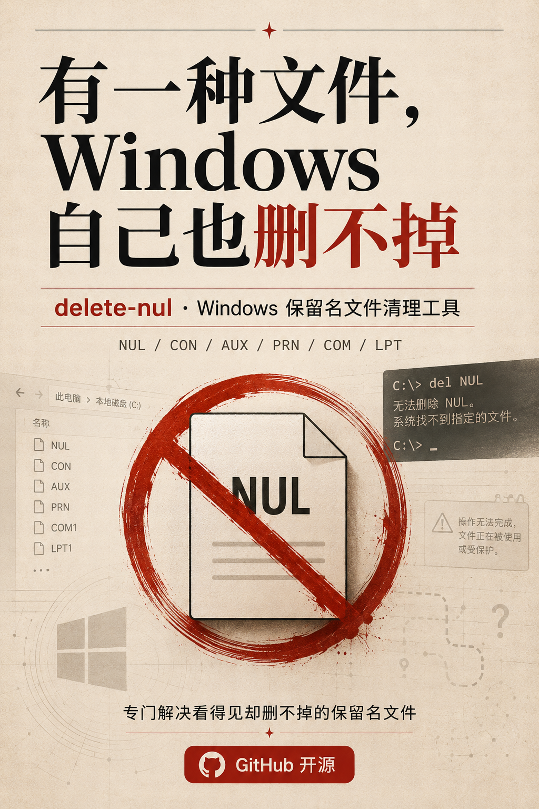
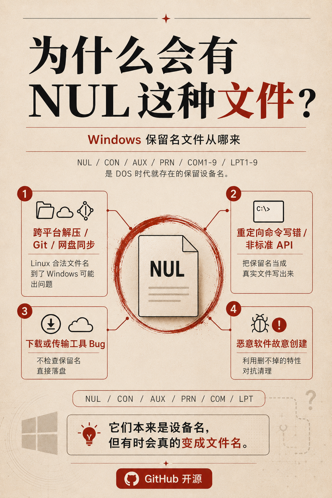
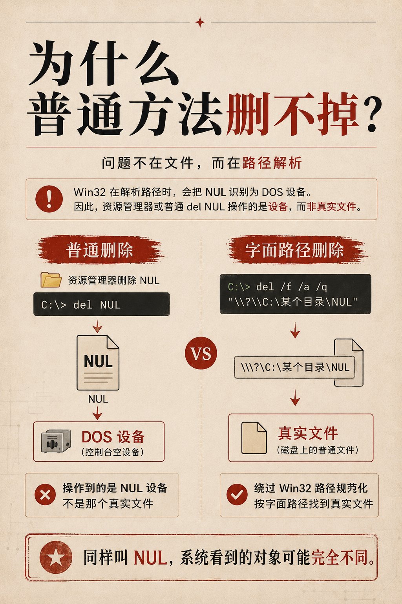
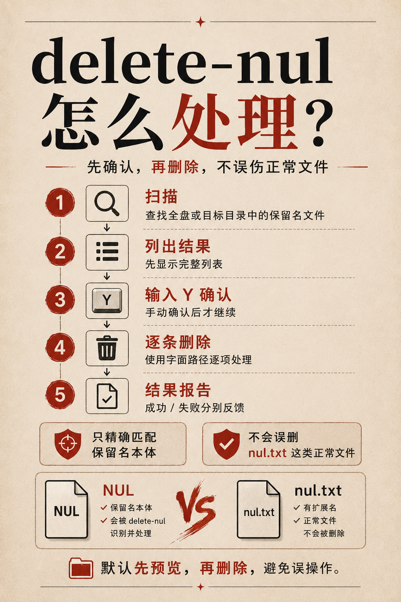
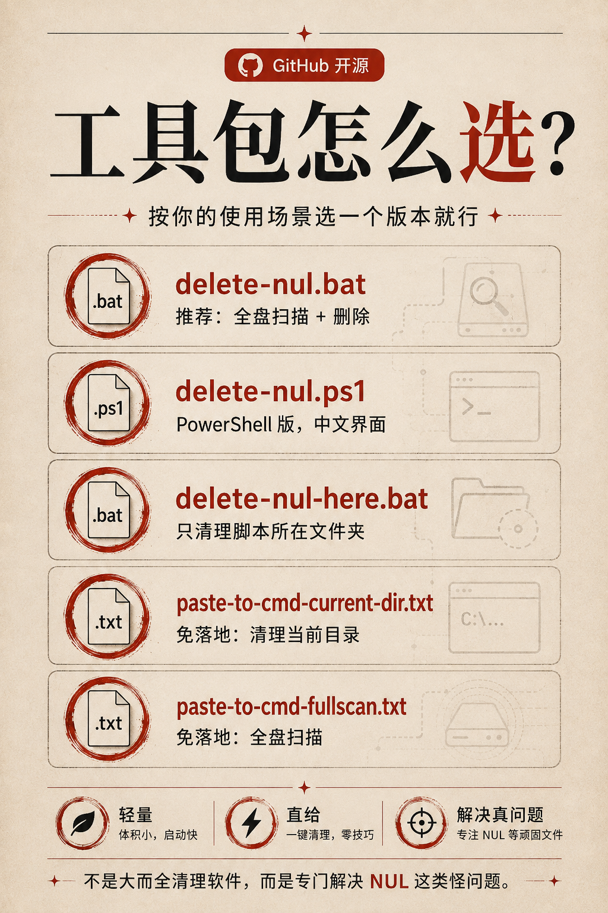

<p align="center"></p>

# delete-nul 工具集 | Windows Reserved-Name File Cleaner Toolkit

Windows 保留名文件（NUL / CON / AUX / PRN / COM1-9 / LPT1-9）的查找与删除工具。
Find and delete Windows reserved-name files that cannot be removed by normal means.

**共同行为 | Common behavior:** 先列出全部结果 → 确认（输入 Y，或用 `-Yes` 跳过）才删除 → 逐条报告成功/失败。默认只匹配保留名本体（`NUL`），不会动 `nul.txt`；如需把带扩展名的也算上，用 `-IncludeExtension`。
List first → confirm (Y, or skip with `-Yes`) → delete with per-file report. By default only the bare name (`NUL`) is matched; `nul.txt` is left alone. Use `-IncludeExtension` to opt in.

<p align="center">
  
  
  
  
</p>

---

## 一、文件列表 | Files

| 文件 File | 用途 Purpose | 依赖 Dependency |
|---|---|---|
| [delete-nul.ps1](delete-nul.ps1) | **核心 CLI**：扫描、确认、删除、报告、JSON、日志。自动 UAC。The core CLI (auto-elevates) | PowerShell 5.1+ |
| [delete-nul.bat](delete-nul.bat) | 双击入口；参数透传，**拖入的文件/文件夹自动变成定向处理路径**。Entry; dropped items become `-Path`. | 需要同目录的 delete-nul.ps1 |
| [delete-nul-here.bat](delete-nul-here.bat) | 只清理该 bat 所在文件夹。Cleans only its own folder | 需要同目录的 delete-nul.ps1 |
| [paste-to-cmd-current-dir.txt](paste-to-cmd-current-dir.txt) | 免落地：粘贴进 cmd 清理当前目录（纯 CMD）。Paste into cmd for current dir | 无 |
| [paste-to-cmd-fullscan.txt](paste-to-cmd-fullscan.txt) | 免落地：粘贴进 cmd 全盘扫描（纯 CMD）。Paste into cmd for full scan | 无 |

> 若不想依赖 PowerShell，用两个 `paste-to-cmd-*.txt`（纯 CMD，无文件落地）。
> No PowerShell? Use the two `paste-to-cmd-*.txt` files (pure CMD, no files on disk).

### 两种模式 | Two modes

**默认不提权**：普通权限即可删除个人目录里的保留名文件，而且提权会触发 Windows 的 UIPI 机制，导致资源管理器无法把文件拖进高权限窗口。只有要删系统目录时才加 `-Elevate`。

双击 `delete-nul.bat`（不带参数、交互终端）会显示：

```
==================================================
 delete-nul · 选择扫描模式 / Select scan mode
==================================================
 用 ↑ ↓ 选择，回车确认（G/S/C/D/Q）；Home 返回主页。
 > [G] 全局扫描   扫描所有本地磁盘（最全，但慢）
   [S] 定向处理   选磁盘 → 浏览目录
   [C] 扫描当前目录 F:\你所在的位置
   [D] 粘贴路径   输入文件或文件夹路径（Shift+右键复制地址再粘贴）
   [Q] 退出
```

- **全程方向键导航，不用输入编号**：`↑ ↓` 移动高亮，回车确认。`G/S/D/Q` 快捷键，`Home` 返回主页，`Esc/Backspace` 返回上一层。非交互终端自动退回文字输入。
- **全局扫描（G）**：扫全部本地固定盘。大容量盘很慢，建议配合 `-Fast` 或 `-ScanTimeout`。
- **扫描当前目录（C）**：直接扫描你运行脚本时所在的目录。即使经历 UAC 提权，也会指向你最初启动的位置（当前路径被记录下来并在提权时传递）。
- **定向处理（S）**：方向键选磁盘 → 进入**文件夹浏览器**：
  ```
  当前目录: C:\Users\me
   用 ↑ ↓ 选择，回车进入；V 选定当前目录，.. 上一层，Home 返回主页。
   > [V] 选定当前目录  C:\Users\me
     [..] 上一层
     [H] 返回主页
         Documents\
         Downloads\
         ...
  ```
  逐层进入子目录，`[..]` 回上一层，`[H]`/`Home` 回主菜单，`[V]` 选定当前目录作为扫描目标。
- **粘贴路径（D）**：纯 CLI——在资源管理器里 **Shift+右键 → 复制文件地址**，然后 Ctrl+V 粘贴。兼容带引号/空格/分号分隔的多个路径，文件和目录都认。**不弹任何窗口**。

### 拖拽到 bat 图标（推荐，最省事）

把文件或文件夹（**包括 NUL 文件本身**）直接拖到 `delete-nul.bat` 或 `delete-nul-here.bat` 图标上即可，支持一次拖多个：

- 拖到 `delete-nul.bat`：处理拖入的项目
- 拖到 `delete-nul-here.bat`：有拖入时处理拖入项，无拖入时扫该 bat 所在文件夹

拖入路径写入临时清单传给 ps1（因为 `powershell.exe -File` 对数组参数只绑定一个值），处理完自动删除。注意拖入的是**保留名文件本身**时也能识别（路径按原样保留，不经过会把 `NUL` 变成设备路径的 `GetFullPath`）。

> 如果图标显示禁止符号：通常是 `.bat` 被关联到编辑器、拖拽源是压缩包内的虚拟路径，或 Explorer 与目标的权限级别不一致——这些是资源管理器/shell 层面的限制。请改用菜单里的 `[D] 粘贴路径`（Shift+右键复制地址）。

自动化场景不要菜单：直接给 `-Path`、或用 `-Mode global` / `-Yes` / `-Format json` 跳过交互。

---

## 二、CLI 参数 | CLI parameters

```
delete-nul.ps1 [选项]
```

| 参数 Parameter | 说明 Description |
|---|---|
| `-Mode auto\|global\|select` | 扫描模式。`auto`（默认）有 `-Path` 就定向处理、非交互时全局扫描、否则弹菜单二选一；`global` 全盘；`select` 交互式选盘/粘贴路径。 |
| `-Path <dir[]>` | 定向处理的根目录（可多个），也可由拖拽传入。Target roots; also supplied by drag-and-drop. |
| `-DryRun` | 只列出不删除。List only. |
| `-Yes` | 跳过删除确认（非交互），隐含退出前不暂停。Skip confirmation (non-interactive). |
| `-Elevate` | 主动申请管理员权限（默认不提权，因为提权会阻止拖拽）。Request admin rights (off by default). |
| `-StartDir <dir>` | 启动目录（内部使用，"扫描当前目录"选项在提权后据此定位）。Launch dir for the C option. |
| `-NoElevate` | 兼容旧用法的空开关（现在默认就不提权）。Kept for compatibility; no-op. |
| `-IncludeExtension` | 连 `NUL.txt` 这类带扩展名的也匹配。Also match `NUL.txt`. |
| `-Fast` | 快速模式：跳过 Windows / Program Files / node_modules / .git 等噪音目录（不保证覆盖这些目录），改用兼容遍历器。Skip noisy dirs. |
| `-Mft` | **实验性**：直接解析 NTFS `$MFT` 索引，跳过目录遍历（可快一个数量级）。需管理员 + NTFS，失败自动回退原生扫描。Experimental. |
| `-Log <file>` | 把完整报告追加到文件（UTF-8）。Append report to a file. |
| `-Format text\|json` | JSON 写到 stdout，进度写信息流。JSON to stdout, progress to info stream. |
| `-Quiet` | 不打印扫描进度。Suppress progress. |
| `-NoColor` | 纯文本，不使用任何颜色。Plain output, no colors. |
| `-Spinner auto\|ascii\|braille` | 动画样式；`auto` 在 UTF-8 控制台用 Braille，否则 ASCII。Animation style. |
| `-ScanTimeout <秒>` | 单盘扫描超时（30–3600，默认 300）；超时跳过该盘并终止子进程，避免卡死。Per-drive timeout. |
| `-NoPause` | 退出前不等回车。Do not wait for Enter on exit. |

### 示例 | Examples

```powershell
# 全盘扫描+删除（自动 UAC）
.\delete-nul.ps1

# 只预览某个目录，不删除
.\delete-nul.ps1 -Path 'D:\projects' -DryRun

# 非交互 + JSON 报告 + 日志（适合自动化/CI）
.\delete-nul.ps1 -Yes -NoPause -Format json -Log C:\logs\nul.json

# 双击带参数：用 bat 透传
delete-nul.bat -Path "D:\temp" -DryRun
```

### 扫描过程显示 | Scan display

扫描时会在原地刷新一行 **ASCII loading 动画**（约 16fps），每个磁盘扫完再输出一行小结：

```
[1/2] 正在扫描 C:\ ...
  | SCAN... C:\  native scan  3 found  12.4s  [.:===>.....]
      完成：发现 3 个，耗时 12.4s
[2/2] 正在扫描 D:\ ...
```

ASCII loading 由三层叠加：旋转 spinner `|/-\` + 循环省略号 `SCAN → SCAN. → SCAN.. → SCAN...` + 来回扫掠的 `===>` 头部与行进的背景波纹 `.:`。
Braille 模式（UTF-8 控制台默认）则是 `⠋⠙⠹…` + 滑动窗口 `[###........]`；强制 braille 但控制台不支持 UTF-8 时会自动回退 ASCII 并提示。

- 实时行通过 `\r` 原地覆盖，**不依赖任何第三方模块**，也不用 `Add-Type`（对杀软友好）。
- 输出被重定向到文件、或用 `-Format json` / `-Quiet` 时，实时行自动关闭，保证日志/JSON 干净。
- 进度条是不确定式（indeterminate）——因为无法在不二次扫描的前提下预知总数。
- 默认原生扫描不统计目录数（原生进程不向 PowerShell 汇报进度），`-Fast` 兼容模式仍显示目录数。

### 权限判定 | Privilege

**默认以普通权限运行**，标题栏显示 `权限: 普通用户`。个人目录里的保留名文件普通权限就能删（已实测）。

只有删除系统目录里的文件失败时，才需要显式加 `-Elevate` 申请管理员权限：

```
delete-nul.bat -Elevate -Path "C:\Windows\某目录"
```

> 为什么不再自动提权：提权后的窗口是 high integrity，Windows 的 UIPI 机制会阻止普通权限的资源管理器把文件拖进去——这正是"拖进去没反应"的根因。改成默认不提权后，拖拽到 bat 图标就能正常工作。

### 退出码 | Exit codes

| 码 Code | 含义 Meaning |
|---|---|
| 0 | 成功 / 无发现 / DryRun。Success, nothing found, or dry run. |
| 1 | 用户取消。User cancelled. |
| 2 | 有项目删除失败。At least one item failed to delete. |
| 3 | 无法确定扫描根目录（例如只有网络盘）。No usable scan root. |

JSON 输出字段：`admin, roots, pattern, dryRun, includeExtension, scanner (native|walker), scanned (仅 walker 模式为目录数), elapsedSeconds, cancelled, found, deleted, failed, items[{path,status}], exitCode`。

### 为什么扫描曾经过慢 / Why scanning used to be slow

旧版在 PowerShell 里逐目录枚举**所有文件**并对每个条目跑正则，每目录约 7 次系统调用，目录一多就爆炸。现在默认改用**原生 `dir /s /b /a` + `findstr`**（过滤在 C 代码里完成），实测对比：

| 目录规模 | 旧 walker | 原生扫描 |
|---|---|---|
| 14,460 目录 | 8.6s | **2.5s** |
| `C:\Windows`（83,726 目录） | 82s | **32s** |

想更快就加 `-Fast`——它跳过 Windows、Program Files、node_modules、.git 等几乎不可能藏保留名文件的目录，通常能再快一个数量级（代价是不覆盖这些目录）。原生扫描失败时会自动回退兼容遍历器；单盘超过 `-ScanTimeout`（默认 300 秒）会跳过该盘，避免某一盘卡住整个流程。

> 注意：默认扫描的是整个盘根目录（如 `C:\`），大容量盘（1TB+）即使原生扫描也可能要十几分钟。扫描开始时会先快速检查目标根目录及前两层子目录，所以即使后续超时，根层的保留名文件也不会漏报。只关心某几个目录时请用 `-Path` 指定，或加 `-Fast`。

真正的数量级提速只有**直接读 `$MFT`**（Everything 索引器的原理），可用实验性 `-Mft` 尝试：

```powershell
delete-nul.bat -Mft                 # 管理员 + NTFS 下直接读 MFT 索引
```

它需要管理员权限和 NTFS，并通过 `Add-Type` 在内存编译一段 C#（可能与"无 Add-Type"的洁癖冲突，且少数 AV 可能敏感）。任何环节失败都会自动回退原生扫描，不会比默认模式更差。**该模式在开发环境（非管理员）只验证了编译与回退路径，未验证真实 MFT 解析结果——请在你的机器上先加 `-DryRun` 试用并与默认模式对比结果，确认无误后再用于删除。**

---

## 三、为什么会有 NUL 这种文件？| Why do NUL files exist?

`NUL`、`CON`、`PRN`、`AUX`、`COM1~9`、`LPT1~9` 是从 DOS 时代继承的**设备保留名**，但以下场景仍会产生"名叫 NUL 的真实文件"：

1. **重定向命令写错位置**：如 `copy a.txt NUL` 在某些非标准 API 下把 NUL 当真实文件名创建；
2. **跨平台解压 / Git / 网盘同步**：Linux 下 `nul`、`aux.c` 是合法文件名，同步到 Windows 被字面创建；
3. **下载/传输工具 bug**：不检查保留名直接落盘；
4. **恶意软件故意创建**：利用"删不掉"的特性对抗清理。

These names are DOS-era device names reserved by Windows. Real files named `NUL` still appear when: redirection commands misuse non-standard APIs; cross-platform archives/Git/cloud-sync bring Linux-legal names over; buggy transfer tools write them literally; or malware creates them deliberately to resist cleanup.

---

## 四、为什么普通方法删不掉？| Why can't they be deleted normally?

Win32 API 在**解析路径阶段**就把 `NUL` 识别成 DOS 设备对象而非文件——资源管理器和普通 `del NUL` 操作的都是"NUL 设备"，不是那个真实文件。

解决方法：给路径加 `\\?\` 前缀，跳过 Win32 路径规范化、直达 NT 对象管理器，此时它就是字面上的文件路径：

The Win32 path resolver treats `NUL` as a DOS device object, not a file. Prefixing the path with `\\?\` bypasses normalization and addresses the literal file:

```bat
del /f /a /q "\\?\C:\某个目录\NUL"
```

枚举不受影响（`dir` / .NET 枚举都能正常列出），所以流程是：枚举 → 按名字精确匹配 → 记录完整路径 → 加 `\\?\` 前缀删除 → 复核报告。
Enumeration works fine, so: enumerate → match exact names → record full paths → delete via `\\?\` → verify and report.

---

## 五、一行命令：远程下载并执行 | One-liner: download & run

> ⚠️ 仅当你信任脚本来源时使用；杀软可能对"下载并执行"链路报警。
> Use only with a trusted source; antivirus may flag download-and-execute chains.

```bat
curl -fsSL "https://raw.githubusercontent.com/yancongya/delete-nul/main/delete-nul.ps1" -o "%TEMP%\delete-nul.ps1" && curl -fsSL "https://raw.githubusercontent.com/yancongya/delete-nul/main/delete-nul.bat" -o "%TEMP%\delete-nul.bat" && call "%TEMP%\delete-nul.bat"
```

不想下载？直接全盘扫描预览（安全，只列出不删除）：
Or preview without downloading (safe, list only) — see `paste-to-cmd-fullscan.txt` PART 1.

仓库地址：<https://github.com/yancongya/delete-nul>

---

## 六、常见问题 | FAQ

- **闪退 / 被杀软删除？Crashed or killed by antivirus?**
  当前 bat 只是调用 ps1 的薄包装，无 Base64、无混淆。杀软若仍拦截"下载并执行"链路，请将本文件夹加入白名单，或直接用 `paste-to-cmd-*.txt` 纯 CMD 方式。
  The bat is now an unobfuscated thin wrapper around the ps1. If AV still flags the download-and-execute chain, whitelist the folder or use the pure-CMD `paste-to-cmd-*.txt` snippets.
- **提示 FAILED？Items marked FAILED?**
  文件被占用或权限不足；关闭占用程序或在管理员窗口重跑（bat 会自动 UAC）。Locked or access denied; close the locker or rerun elevated.
- **能恢复吗？Can deleted files be recovered?**
  删除不进回收站，务必核对列表后再按 Y。Deletion skips the Recycle Bin — always review the list before pressing Y.
- **会误删 `nul.txt` 吗？Will it delete `nul.txt`?**
  默认不会。如需连同带扩展名的保留名一起处理，显式加 `-IncludeExtension`。No by default; pass `-IncludeExtension` to opt in.
- **ps1 运行方式 | Running the ps1**
  右键 → 使用 PowerShell 运行；或命令行：
  ```powershell
  powershell -NoProfile -ExecutionPolicy Bypass -File .\delete-nul.ps1
  ```

---

F:\delete-nul · delete-nul toolkit · README
